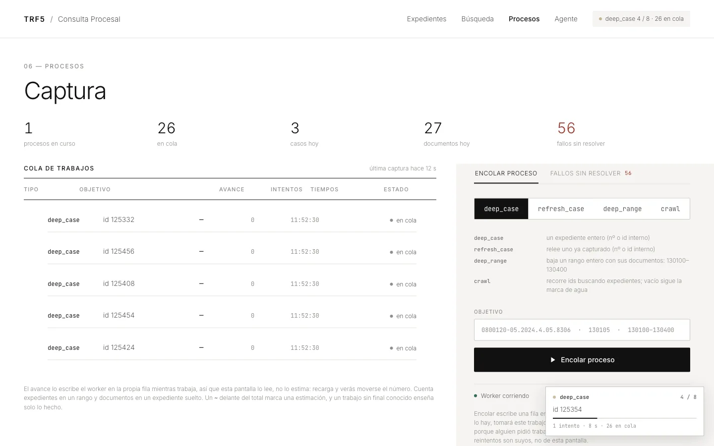
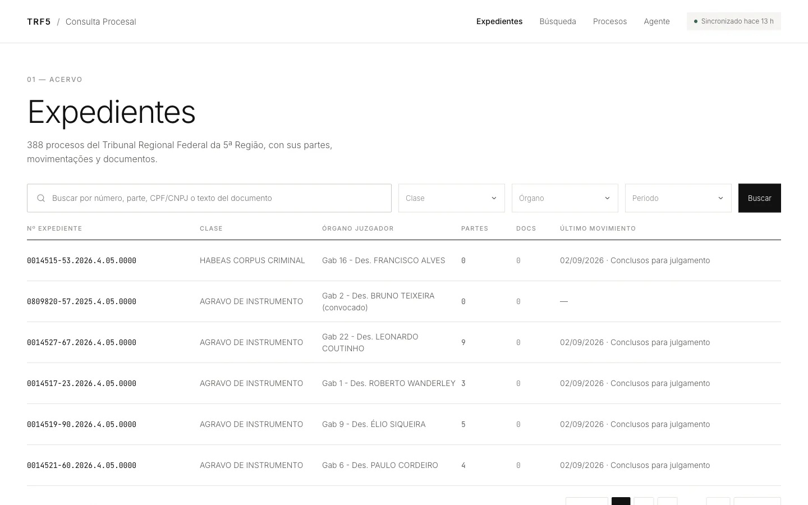
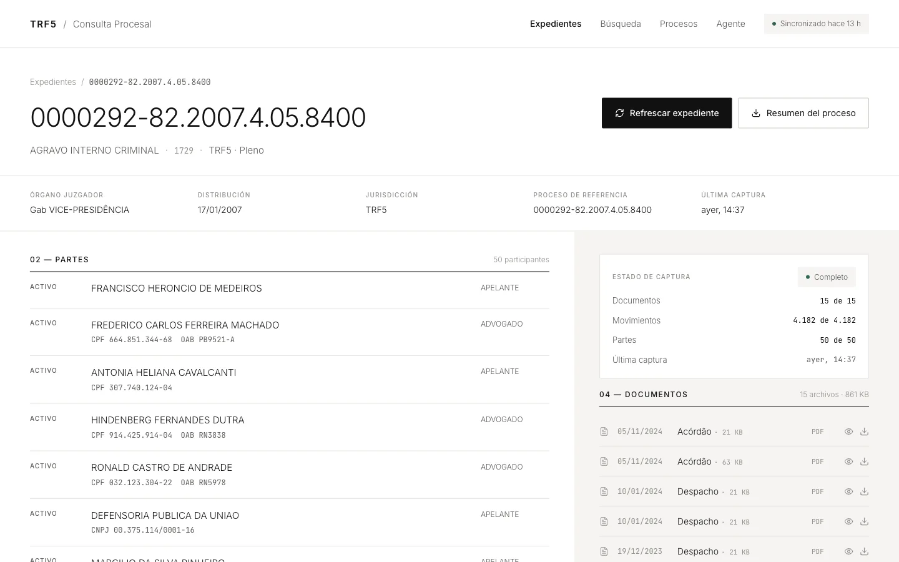
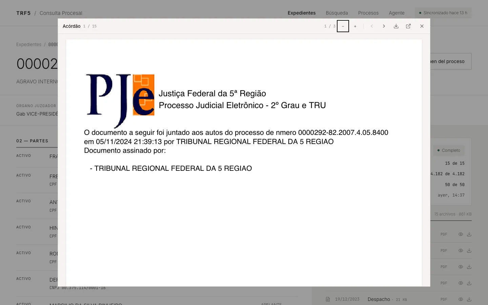
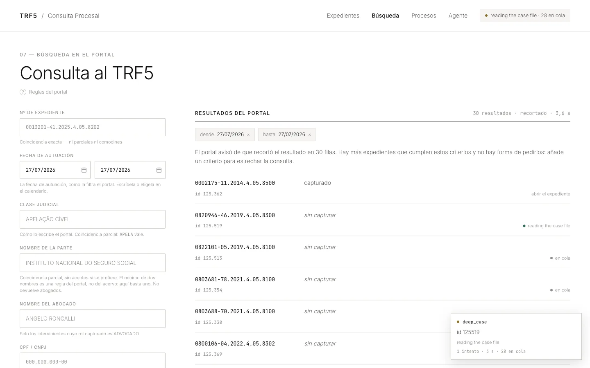
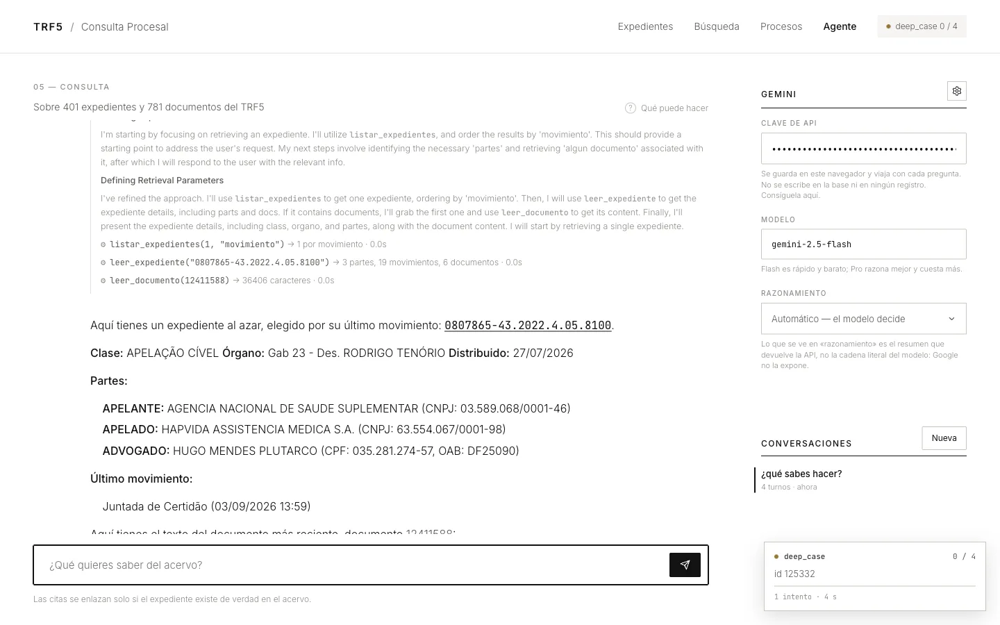
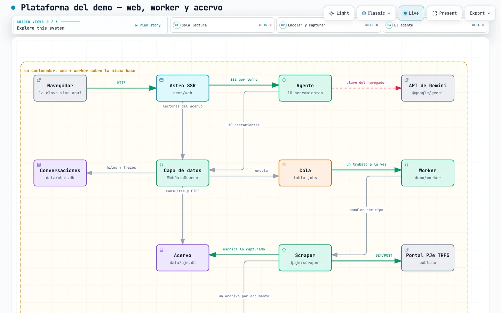
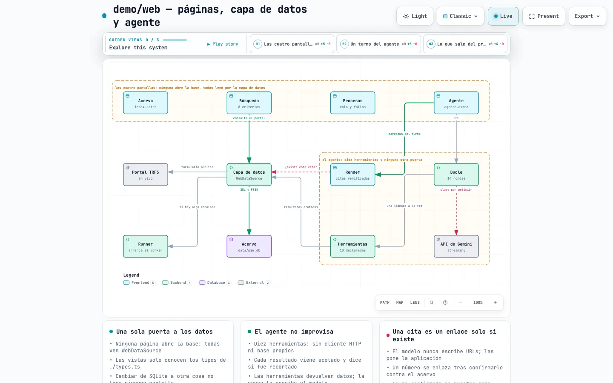
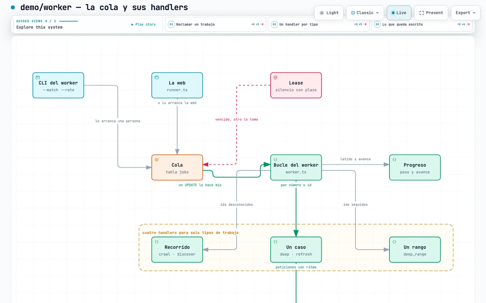

# El sistema construido alrededor del scraper

El enunciado pedía un scraper. Un scraper que nadie puede operar es un script,
así que este repositorio lleva también lo que hace falta para usarlo: una cola
de trabajos, un worker, cuatro pantallas y un agente que responde sobre lo
capturado y puede ir a capturar más.

[](diagramas/demo.html)

Nada de esto hace falta para satisfacer el reto —borrar `demo/` deja un scraper
que funciona y una suite que pasa—. Está aquí porque es la respuesta honesta a
«¿y entonces qué?».

## Un solo comando

El scraper corre por su cuenta. Si prefieres ver el conjunto funcionando sin
instalar Node:

```bash
docker build -t trf5 .
docker run -p 4321:4321 -v trf5-data:/app/data trf5
```

El contenedor levanta la web y un worker, y encola la primera captura **como
trabajo** en vez de sembrar la base en silencio — así, abriendo
<http://localhost:4321/procesos> unos segundos después, hay una captura real en
marcha, con su paso, su avance y sus fallos. Ese es el punto: el sistema está
hecho para verse mientras trabaja.

```
seed: encolado el trabajo #1 — captura profunda de ids 130100–130140
[@astrojs/node] Server listening on http://localhost:4321
Worker draining and then watching for more at 2 req/s
▶ job 1  deep_range
✓ job 1: 3 cases captured, 0 failed, 9 documents stored  (18.8s)
```

El volumen guarda la base y los PDF, así que reiniciar conserva lo capturado —y
la siembra se salta si el acervo ya tiene algo—. Si no se alcanza al tribunal
(solo responde desde algunas redes), **el contenedor arranca igual**: la
búsqueda, las fichas y el agente funcionan sobre lo que ya está guardado, y el
fallo aparece en la cola en vez de matar el proceso. `SEED_RANGE=""` desactiva
la primera captura; `SEED_RATE` baja el ritmo.

## Las pantallas

Cuatro, todas leyendo el mismo acervo por una sola interfaz. Ninguna abre
SQLite y ninguna captura nada.



Una ficha dice lo que la captura consiguió de verdad — *50 de 50 partes, 4.182
de 4.182 movimientos, 15 de 15 documentos*. Una captura que se quedó corta lo
dice, en vez de enseñar un tick verde:



Los documentos se abren en un visor sobre pdf.js, no en el del navegador, así
que el texto sigue siendo seleccionable y lo que rodea a la página es nuestro:



Una búsqueda en vivo contra el portal **encola lo que el tribunal tiene y
nosotros no**, y cada fila va contando su propia captura:



## El agente

Diez herramientas y ninguna otra puerta: sin cliente HTTP propio, sin acceso
directo a la base. Cada afirmación suya tiene que volver por una herramienta, y
eso es lo que convierte «cita lo que afirmes» en algo exigible y no en una
súplica dentro de un prompt.

Su razonamiento se enseña, no se esconde. Pidiéndole un expediente cualquiera
con sus partes y algún documento, encadenó tres herramientas y lo dejó a la
vista:



El número de expediente de esa respuesta es un enlace. Uno que el modelo se
invente, no: **una cita se convierte en enlace solo después de que el acervo
confirme que existe**, y la que no se puede confirmar se muestra como texto
plano en vez de desaparecer. Equivocarse es sobrevivible; equivocarse
disfrazado de verificado, no.

Y el caso límite se ve mejor en la cita literal de una sentencia: ahí aparece un
expediente de un tribunal estatal que no tenemos, con subrayado punteado y sin
enlazar. La aplicación lo enseña y se niega a fingir que puede abrirlo.


## La arquitectura

Diagramas navegables: abre el HTML para desplazarte, buscar y resaltar una
relación.

### La plataforma — web, worker y acervo

[](diagramas/demo.html)

[Abrir](diagramas/demo.html)

### `demo/web` — pantallas, capa de datos y agente

[](diagramas/web.html)

[Abrir](diagramas/web.html)

### `demo/worker` — la cola y sus handlers

[](diagramas/worker.html)

[Abrir](diagramas/worker.html)

## Por qué existe cada pieza

- **La cola es una tabla.** Reclamar un trabajo es un solo `UPDATE`
  condicionado, así que varios workers pueden drenarla sin pisarse, y un
  trabajo que lleva demasiado tiempo en silencio puede reclamarlo otro. Sin
  broker y sin demonio: arrancas un worker cuando hay trabajo.
- **Avance que se puede mirar.** Cada trabajo publica su paso y sus cuentas
  contra el *intento vivo* — un worker cuyo trabajo fue reclamado de nuevo no
  puede sobrescribir el avance del que se lo llevó.
- **Cuatro pantallas y una sola puerta a los datos.** Ninguna abre SQLite:
  todas pasan por la misma interfaz, así que cambiar de almacenamiento no toca
  ninguna vista.
- **Un agente sin atajos.** Diez herramientas, resultados acotados que avisan
  cuando recortan, y ninguna forma de afirmar algo que no haya consultado.

## Qué cambiaría en producción

La cola es una tabla SQLite a propósito. Es la decisión correcta para un
entregable que tiene que arrancar con un `docker run` y sin credenciales, y la
equivocada para escalar. Llevando esto a GCP de verdad, la forma apenas cambia
y se sustituyen tres piezas:

- **Cloud Tasks en lugar de la tabla `jobs`.** El límite de ritmo por cola y el
  máximo de despachos concurrentes son exactamente las perillas que este
  scraper necesita, y pertenecen a la infraestructura antes que a una bandera
  `--rate`. El lease y los reintentos ya modelados aquí encajan en su plazo de
  despacho y su configuración de reintentos.
- **Pub/Sub para el avance, en vez de sondeo.** Las pantallas consultan
  `/cola.json` cada 1,5 s, lo cual está bien para un operador y mal para
  muchos. Publicar los eventos del worker en un topic y empujarlos al navegador
  elimina el sondeo y deja esos mismos eventos disponibles para cualquier otra
  cosa que los quiera.
- **Workers en Cloud Run y los PDF en Cloud Storage.** El worker ya es un
  proceso que reclama un trabajo y termina; eso es un job de Cloud Run sin
  cambios. `BlobStore` es una interfaz con una implementación sobre el sistema
  de archivos — una sobre GCS es la misma interfaz, y ningún llamador cambia.

Lo que **no** cambiaría: el parseo, la taxonomía de fallos, la precedencia de
fuentes para los movimientos, y la regla de que una lectura incompleta se
registra en vez de descartarse en silencio. Esas son las partes que costaron el
tiempo, y son agnósticas del almacenamiento a propósito.
