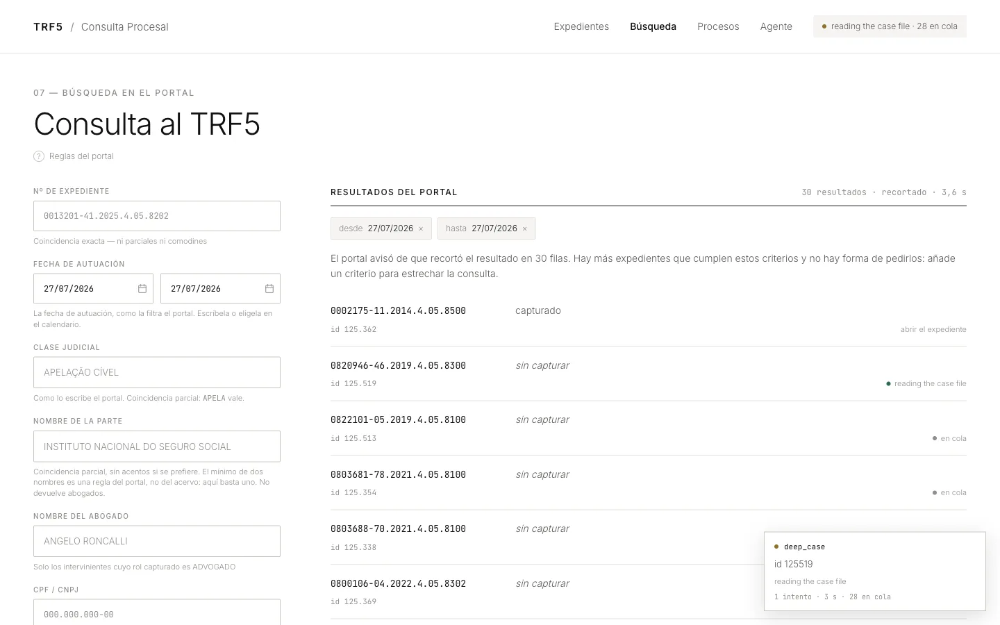
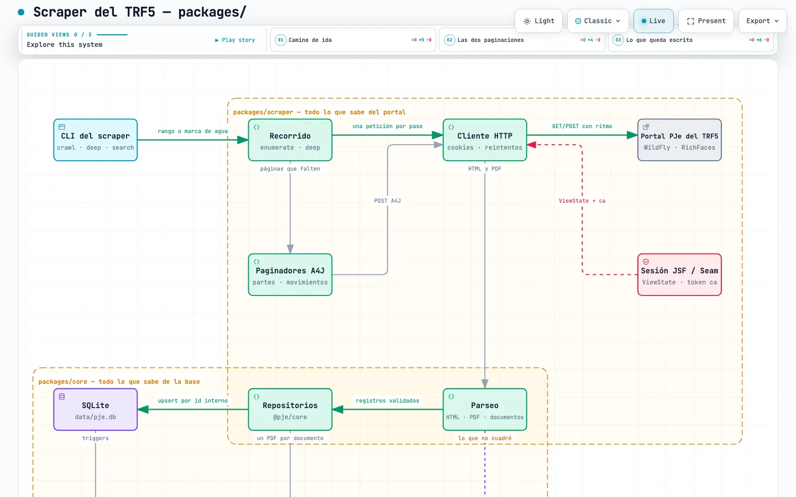

# pje-trf5-scraper

Un scraper en TypeScript para el portal público de consulta procesal del
**TRF5** (Tribunal Regional Federal da 5ª Região), y la plataforma que hace
falta para operarlo.



Una búsqueda por fecha contra el portal del tribunal, en vivo. Los 30 expedientes que el TRF5 tiene y nosotros no quedan encolados solos, y cada fila  
va contando su propia captura mientras ocurre.

El scraper es el entregable del reto., la imagen es una plataforma demo construida encima de este.

---

## El scraper

Consulta el formulario de búsqueda del portal, enumera expedientes por id
interno para sortear el tope de 30 resultados, sigue cada expediente hasta los
documentos de su ficha, los descarga y guarda todo en SQLite.

**Peticiones HTTP y parseo de HTML y PDF. Sin automatización de navegador** —
nada en este repositorio depende de Playwright, Puppeteer ni Selenium, y las
únicas dependencias del scraper son `cheerio` y `better-sqlite3`. El `fetch`
nativo de Node hace el resto.

### Instalar

Node &gt;=22. No hay paso de compilación ni nada que aprovisionar.

```bash
npm install
npm run scraper -- --help
```

Capturar un expediente, con todos los documentos de su ficha:

```bash
npm run scraper -- case 0013201-41.2025.4.05.8202
```

O un rango, que es lo que parece una ejecución real:

```bash
npm run scraper -- crawl --from-id 130100 --to-id 130120
```

> **El `--` no es opcional.** `npm run scraper -- search …` le pasa las banderas
> al scraper; `npm run scraper --search …` hace que npm se las coma.

### Los comandos


|          |                                                                                                              |
| -------- | ------------------------------------------------------------------------------------------------------------ |
| `search` | el formulario del portal — mismos campos, misma validación, mismo tope de 30 filas. Imprime JSON por defecto |
| `crawl`  | enumera expedientes por id interno. Este es el de cobertura completa                                         |
| `case`   | un expediente y todos los documentos de su ficha                                                             |
| `deep`   | lo mismo, sobre un rango de ids                                                                              |
| `daily`  | avanza la marca de agua: solo lo posterior a la última ejecución                                             |
| `find`   | búsqueda de texto completo sobre lo ya capturado, sin red                                                    |


Todos aceptan `--dry-run`, `--json`, `--rate`, `--concurrency` y las banderas
de nivel de registro.

**→ [`CLI.md`](CLI.md) es la referencia completa**: cada bandera, la salida de
progreso, las formas del JSON, cómo funciona la reanudación y dónde acaba cada
archivo.

## El reto, requisito por requisito


| Lo que pedía el enunciado             | Dónde está                                                                | Compruébalo                                                 |
| ------------------------------------- | ------------------------------------------------------------------------- | ----------------------------------------------------------- |
| TypeScript, sin build                 | `packages/`, con `node --experimental-strip-types`                        | `npm run scraper -- --help`                                 |
| **Sin automatización de navegador**   | `fetch` nativo + `cheerio`                                                | `npm ls playwright puppeteer selenium` no encuentra ninguno |
| Navegar todo el sitio                 | `crawl` enumera por id interno, más allá del tope de 30                   | `npm run scraper -- crawl --from-id 130100 --to-id 130120`  |
| Toda la información de cada documento | expediente, partes, movimientos y documentos                              | `npm run scraper -- deep 0013201-41.2025.4.05.8202`         |
| Descargar los PDF                     | un archivo por documento, nombrado por su expediente y fecha              | `ls data/pdfs`                                              |
| **429 con backoff exponencial**       | `packages/scraper/src/http/backoff.ts`, respetando `Retry-After`          | [¿Cómo se comporta?](HALLAZGOS.md)                          |
| Registrar los fallos para reintentar  | la tabla `failures`, con el motivo; un reintento rehace solo lo que falló | vuelve a ejecutar el mismo comando                          |
| Salida estructurada                   | SQLite; `search` imprime JSON por defecto, `--json` en el resto           | `npm run scraper -- find "uniao" --json`                    |


### Lo que el portal hace de verdad

La mitad interesante de este problema no es parsear HTML. Es que este portal
**responde a una petición fallida con un éxito**: una búsqueda cuya acción
nunca se ejecutó devuelve la página vacía con HTTP 200, un paginador al que le
mandas el envoltorio equivocado vuelve a dibujar la página uno, y una ficha
llega en ISO-8859-1 mientras sus propios fragmentos AJAX llegan en UTF-8, sin
declarar ninguno de los dos.

Cada una de esas es una forma de acabar con una base de datos que **parece
completa y no lo está**. El código está construido para hacer eso imposible:
una lectura incompleta se registra como fallo con su motivo, nunca se descarta
en silencio.

**→ [`HALLAZGOS.md`](HALLAZGOS.md)** cuenta cada una, con el manejo de 429 y
las dos formas del token `ca` que rompían las búsquedas sobre expedientes
antiguos.

## Arquitectura



La sesión JSF, los dos paginadores A4J —que necesitan envoltorios distintos—, el
parseo, SQLite y el índice FTS5. 

Es un diagrama navegable:
[ábrelo](diagramas/scraper.html) para desplazarte, buscar un componente o
resaltar una relación.

Dos paquetes, con las dependencias en un solo sentido: `scraper` depende de
`core`, y `core` no sabe nada de `scraper`.

- `**packages/core**` — el almacenamiento. El esquema SQLite (`cases`,
`documents`, `parties`, `movements`, `probes`, `failures`), repositorios
tipados sobre cada tabla, el índice FTS5 y un almacén de blobs sobre el
sistema de archivos para los PDF (`BlobStore`, intercambiable por
almacenamiento en la nube sin tocar a quien lo llama).
- `**packages/scraper**` — todo lo que habla con el portal y con quien lo usa:
el cliente HTTP con límite de ritmo y reintentos (`src/http/`), el cliente
del protocolo PJe (`src/pje/`), el parser de PDF (`src/pdf/`), los motores de
recorrido (`src/crawl/`) y la propia CLI (`src/cli/`).

---

## El sistema construido alrededor

Un scraper es un script. Este repositorio agrega también una cola de trabajos, un worker, cuatro pantallas y un agente sobre el acervo:

```bash
docker build -t trf5 . && docker run -p 4321:4321 -v trf5-data:/app/data trf5
```

Eso levanta la web y un worker, y **encola una primera captura como trabajo**
en vez de sembrar la base en silencio — porque el sistema está pensado para
verse mientras trabaja.

Una búsqueda en vivo contra el portal encola sola lo que el tribunal tiene y
nosotros no. Un expediente dice lo que su captura consiguió de verdad —*50 de
50 partes, 4.182 de 4.182 movimientos*— y si se quedó corta lo dice, en vez de
enseñar un tick verde. Y el agente tiene diez herramientas y ninguna otra
puerta: sin cliente HTTP ni base propios, así que **cada afirmación suya tiene
que volver por una herramienta**, y una cita solo se convierte en enlace
después de que el acervo confirme que existe.

Son dos paquetes más, `demo/worker` y `demo/web`, y son prescindibles: borrar
`demo/` deja un scraper que funciona y una suite que pasa.

**→ [`PLATAFORMA.md`](PLATAFORMA.md)** — las siete pantallas en imágenes, los
diagramas de la plataforma y de cada módulo, y qué cambiaría para correr esto en
GCP con Cloud Tasks y Pub/Sub.

---

## Pruebas

```bash
npm test          # sin red, contra fixtures
npm run typecheck # tsc --noEmit sobre los cuatro proyectos
```

`PJE_LIVE=1 npm test` añade las pruebas contra el portal real.

## Alcance

El corpus ronda los 133.000 expedientes por `idProcessoTrf`. Al ritmo
sostenible medido —unas pocas peticiones por segundo— un recorrido completo
lleva muchas horas. El enunciado no exige una ejecución completa: las banderas
`--from-id`/`--to-id`/`--limit` existen para ejercitar el motor a la escala que
convenga; unos cientos de expedientes bastan para ver la reanudación, los
reintentos y la clasificación entre ausente, transitorio y almacenado.